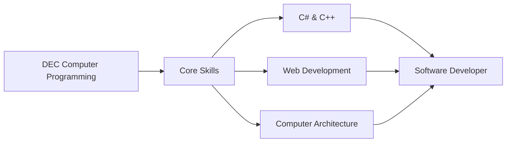

# Personal and Academic Profile

## About Me
My name is Christevie, and I am pursuing a DEC in Computer Programming at Collège LaSalle Montréal. 
I am interested in technology, software development, and problem-solving.

## Academic Coursework
- Web Development
- Algorithms and Programming
- Mathematics
- College English
- French
- Computer Architecture
- Physical Education 

## Technical Skills
Developing foundational knowledge in C#, C++, programming, web development, and computer hardware.

## Personal Strengths
Adaptability, discipline, teamwork, communication, and willingness to learn.

## Professional Interests
Software development, web technologies, computer systems, business management, and innovation.

## Career Objectives
To complete my DEC, gain practical experience, and pursue a career in software or web development, 
with an interest in combining technology and business.

## My Learning Path

